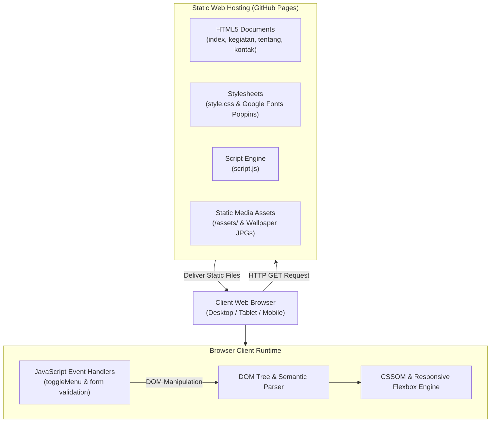

# TheGreatestWallpaper (pratama1246.github.io)

**A static multi-page photography and wallpaper gallery built with semantic HTML5, responsive CSS Flexbox, and vanilla JavaScript.**

[](https://pratama1246.github.io)
[](https://pratama1246.github.io)
[](https://developer.mozilla.org/en-US/docs/Web/HTML)
[](https://developer.mozilla.org/en-US/docs/Web/CSS)
[](https://developer.mozilla.org/en-US/docs/Web/JavaScript)
[](#core-technical-capabilities)
[](LICENSE)

---

## Overview

TheGreatestWallpaper is a client-side static web application showcasing curated landscape photography and wallpapers from locations worldwide, including Seoul, Dieng, Yogyakarta, Thailand, Labuan Bajo, and Switzerland. Developed originally as a Web Programming (*Pemrograman Web*) project by Tama and Nata, the site is designed to deliver a distraction-free visual experience while maintaining low system overhead.

The project runs completely client-side with zero external build tools, bundlers, or server-side dependencies. It requires no database configuration and collects no user telemetry. All static assets and pages are served directly through GitHub Pages.

### Live Demo & Links
- **Production URL**: [https://pratama1246.github.io](https://pratama1246.github.io)
- **Repository**: [https://github.com/pratama1246/pratama1246.github.io](https://github.com/pratama1246/pratama1246.github.io)

---

## Practical Use Cases

- **Curated Nature & Landscape Gallery**: Provides desktop and mobile users with a collection of high-resolution nature and travel photography, complete with direct photographer credits.
- **Academic Web Programming Reference**: Serves as a standard, clean implementation of multi-page static web development using semantic HTML5 tags (`<header>`, `<nav>`, `<main>`, `<article>`, `<footer>`), pure CSS variables, and native DOM manipulation.
- **Lightweight Static Site Template**: Functions as an unbloated foundation for personal portfolios, photo galleries, or organizational landing pages requiring zero build steps or server maintenance.

---

## Core Technical Capabilities

- **Semantic Multi-Page Architecture**: Structured across four distinct entry points—Home (`index.html`), About (`tentang.html`), Activities/Gallery (`kegiatan.html`), and Contact (`kontak.html`).
- **Responsive Flexbox Grid**: Uses a fluid layout container (`flex-wrap: wrap`) with flexible card widths (`flex: 1 1 300px`) that automatically adapt between desktop monitors and handheld screens.
- **Breakpoint-Driven Mobile Drawer**: Native sticky navigation bar (`position: sticky`) with an off-canvas dropdown menu triggered via JavaScript on viewports under 768px (`@media (max-width: 768px)`).
- **GPU-Accelerated Card Elevation**: Smooth micro-interactions on gallery cards using CSS `transform: translateY(-10px)` and drop-shadow transitions.
- **Client-Side Form Validation**: Pure JavaScript validation in `script.js` that checks for missing fields (name, email, message) before form submission without external libraries.
- **Viewport-Relative Typography**: Utilizes CSS viewport units (`vw`) for hero header titles, scaling typography proportionately across differing screen resolutions.
- **Direct Photographer Attribution**: Embedded Unsplash attribution links on all featured photography assets, adhering to open licensing guidelines.

---

## System Architecture



---

## Repository Structure

```text
pratama1246.github.io/
├── assets/
│   ├── logo/
│   │   ├── email.png                         # Email contact icon
│   │   ├── Facebook.png                      # Facebook channel icon
│   │   ├── Instagram.webp                    # Instagram channel icon
│   │   └── X.png                             # X / Twitter channel icon
│   ├── andri-hermawan-mZjSvUtky1A-unsplash.jpg  # Dieng landscape photo
│   ├── eugenia-clara-_QTeGT478_8-unsplash.jpg   # Yogyakarta temple photo
│   ├── mathew-schwartz-gsllxmVO4HQ-unsplash.jpg # Thailand landmark photo
│   ├── ricardo-gomez-angel-58uZCE8zrdk-unsplash.jpg # Swiss mountain photo
│   ├── william-kusno-tq_h8bCNhKQ-unsplash.jpg   # Labuan Bajo coastal photo
│   └── yohan-cho-Mwvhyd22Lyw-unsplash.jpg       # Seoul night skyline photo
├── 2688x1511-WALLSBYJFL.jpg                   # Main header background wallpaper
├── index.html                                 # Homepage: featured wallpapers & hero banner
├── kegiatan.html                              # Gallery page: extended multi-photo showcase
├── kontak.html                                # Contact page: inquiry form & social links
├── script.js                                  # Mobile navigation toggle & form verification
├── style.css                                  # Global stylesheet (Flexbox, variables, media queries)
├── tentang.html                               # About page: organization background & mission
└── README.md                                  # System documentation and deployment guide
```

---

## Deployment & Operational Runbook

This project is hosted on GitHub Pages with automatic deployment from the repository's primary branch.

### Deploying to GitHub Pages

1. Push your changes to GitHub:
   ```bash
   git add .
   git commit -m "docs: update README with project-readme standard"
   git push origin main
   ```
2. Navigate to your repository on GitHub:
   - Go to **Settings** > **Pages**.
3. Under **Build and deployment**:
   - **Source**: Select `Deploy from a branch`.
   - **Branch**: Select `main` and folder `/ (root)`.
4. Click **Save**. GitHub Pages will build and publish the site at:
   ```
   https://<username>.github.io/
   ```

---

## Local Development & Setup

Since the project uses vanilla web standards, no compilation step or package installation (`npm install`) is required.

### Prerequisites
- Modern web browser (Chrome, Firefox, Edge, or Safari)
- Git (optional, for repository management)
- Optional: Python 3 or Node.js (for local HTTP previewing)

### Quickstart

1. **Clone the repository**:
   ```bash
   git clone https://github.com/pratama1246/pratama1246.github.io.git
   cd pratama1246.github.io
   ```

2. **Serve locally using Python**:
   ```bash
   python -m http.server 8000
   ```
   *Alternatively, using Node.js:*
   ```bash
   npx serve .
   ```
   *Or simply double-click `index.html` to open it directly in any browser.*

3. **Access the application**:
   Open your browser and navigate to:
   ```
   http://localhost:8000
   ```

---

## Credits & License

- **Authors**: Pratama Putra ([pratama1246](https://github.com/pratama1246)), Tama & Nata (*Pemrograman Web*)
- **Image Assets**: High-resolution photography provided by independent artists via [Unsplash](https://unsplash.com):
  - [Yohan Cho](https://unsplash.com/@yohoney)
  - [Andri Hermawan](https://unsplash.com/@andrhrw_)
  - [Eugenia Clara](https://unsplash.com/@eugeniaclara)
  - [Mathew Schwartz](https://unsplash.com/@cadop)
  - [William Kusno](https://unsplash.com/@williamkusno)
  - [Ricardo Gomez Angel](https://unsplash.com/@rgaleriacom)
- **License**: Distributed under the [MIT License](LICENSE).
